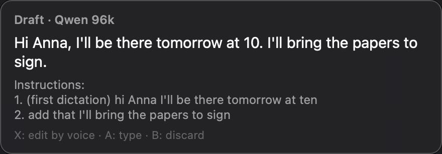
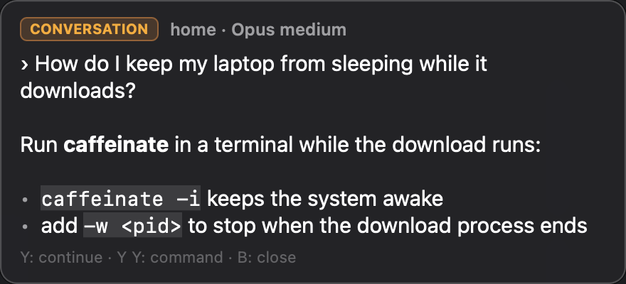
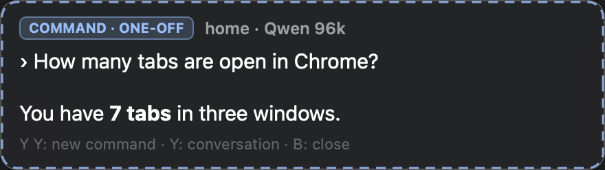
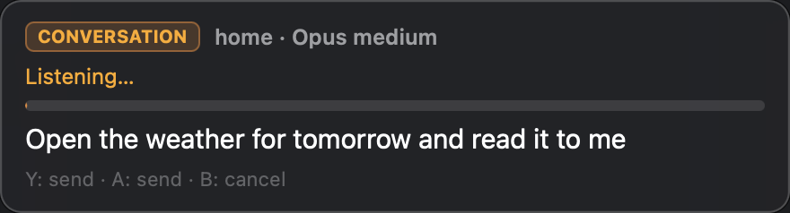
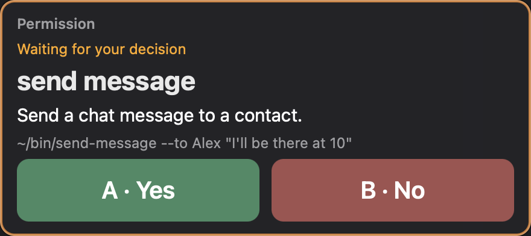
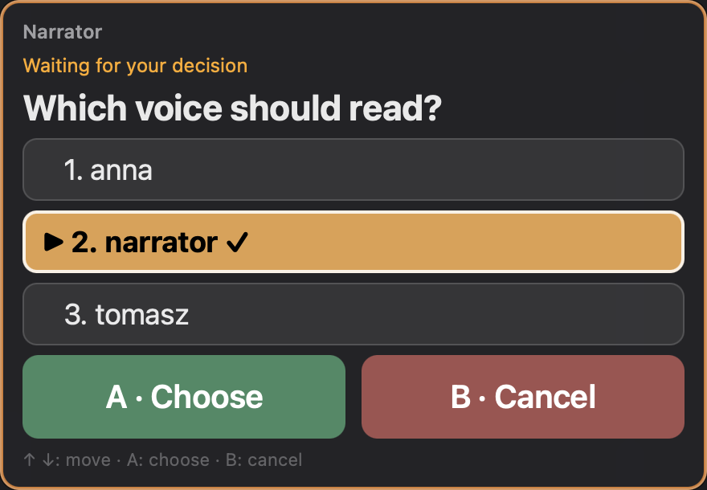
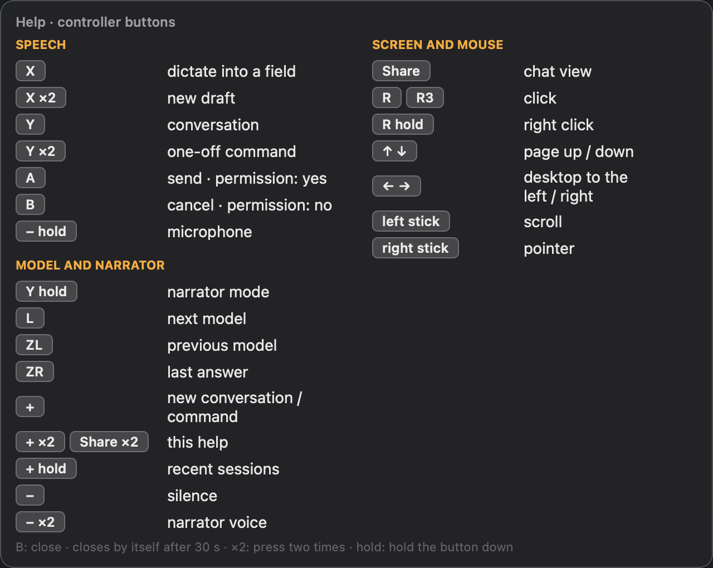
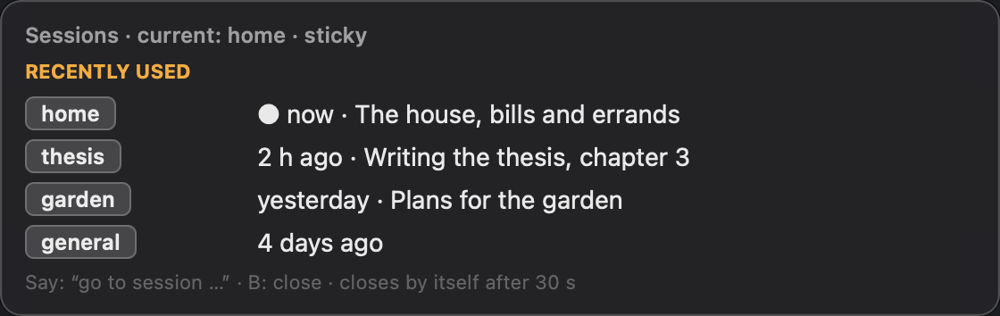
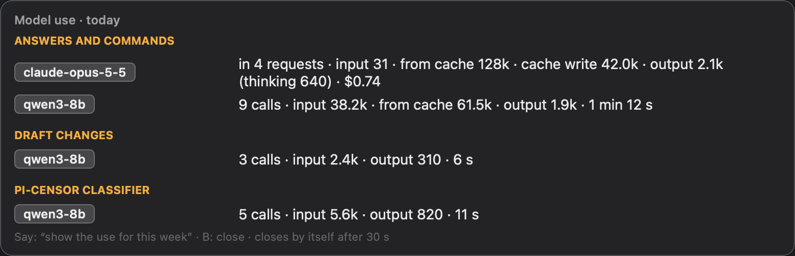
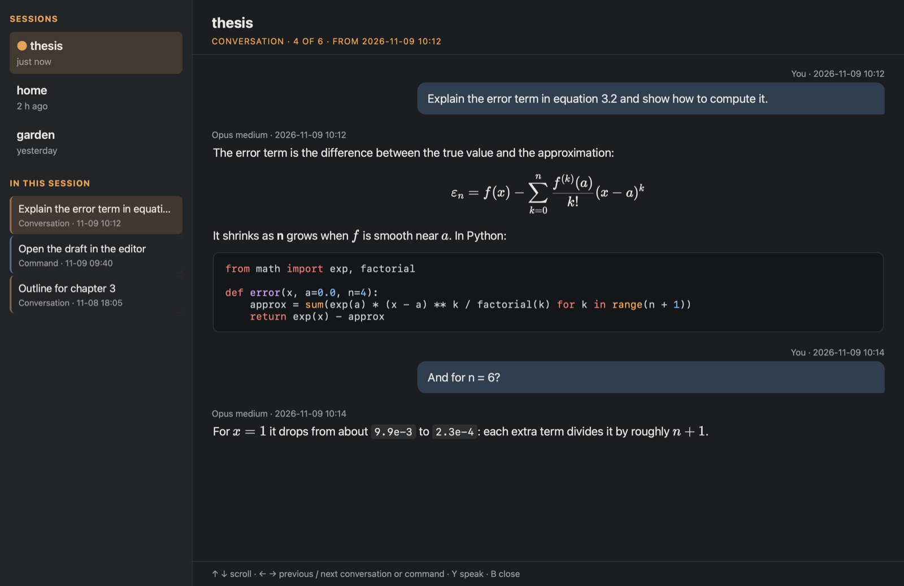

# A tour of Kuterlapa

Kuterlapa lets you use a Mac by voice and a game controller. This page
shows what you see while you use it. The screenshots use made-up example
content; `make screenshots` takes them again (Kuterlapa must run).

Kuterlapa speaks English or Polish: `language` in `config.toml` sets the
labels, the narrator's short notes and the prompts it gives the models.
The pictures below are in English; the same pictures in Polish are in
[`screenshots/pl/`](screenshots/pl/).

## Speaking

### Dictating into a field

X starts dictation into the field in front, X again stops it. Speech
recognition (Whisper, on the Mac) types the text sentence by sentence while
you speak. A ends the dictation, waits for its last words and presses
Enter. B erases what the dictation typed; during a dictation it only ends
it, and with nothing to end it presses Escape.

Speech recognition knows the words of your session (`dictionary.txt`) and
the names in the window in front, and fixes words it often gets wrong
(`replacements.txt`). With `languages = ["pl", "en"]` in `speech.toml` you
may switch languages from sentence to sentence: Whisper finds the language
of each piece, and when it is not sure, it reads the piece in both and
keeps the reading it is surer of. Holding − chooses the microphone: the
system's input, or one you pin (headphones that connect later do not take
it over).

### The draft

X pressed twice starts a draft: a text you build by voice before it goes
anywhere. The first dictation becomes the draft. After that, everything
you say is an instruction for a model ("add that I'll bring the papers",
"make it more polite", a word spelled letter by letter), and the model
changes the draft. The latest instructions stay below it. A types the
draft into the field in front, without Enter: you send it yourself.
`submit.json` can add a key per application.

## The overlay

A small panel in the top right corner of the screen, also over full-screen
applications. It never takes the keyboard focus, so the application below
keeps working, and mouse clicks pass through it. While the overlay shows
something, A and B work in it and do not reach the window below.

### A conversation

Y starts a conversation with a model (Claude through `claude -p`, or a
local model through `pi`) in the current session. The badge
**CONVERSATION** says that it is saved in the session's history. Answers
are Markdown: bold text, lists and code show as such. The title shows the
session and the model profile; L and ZL switch the profile.

While the model works, the overlay shows what it does, in small text: each
tool call with its arguments (⋯ running, ✓ done, ✗ failed), the latest part
of its thinking, the seconds and the tokens so far ("in" is what the model
read, all its calls together; "out" is what it wrote), and how full its
context is. After the answer, one small line keeps the totals.

### A one-off command

Y pressed twice asks a one-off question. It sees the session's context but
is not saved in its conversation. The blue badge **COMMAND · ONE-OFF** and
the dashed frame mark it as temporary: it lasts while its answer is on
screen.

### Listening, and the pause countdown

While you speak, the text appears piece by piece (**Listening…**). A
message sends itself after a pause: after one second of silence a bar
counts down, and speaking again stops it. All three times (pause,
countdown, the shortest recording) are settings.

### A question before a tool runs

Models act through tools: programs described by small TOML files, and
built-in tools that see and use the computer. A tool can ask first. The
overlay then shows the tool's name large, what it does, the exact command,
and two large buttons: **A · Yes** and **B · No**. A frame and a sound make
sure you notice it.

A model can also ask you itself (`ask_user`): yes or no, or one of a few
options. Options stand one under another; the d-pad's up and down move the
mark, A chooses, B cancels.

pi runs in its RPC mode, so its extensions can ask too. When pi-censor is
unsure of a tool call, its question (allow once, allow for the rest of the
conversation, deny) shows the same way.

The same goes for Claude Code running in tmux, here or on another host by
SSH. Holding X (`claude-ask`) reads the question that Claude Code in
iTerm's front tab waits on and shows it in the overlay: several questions
one after another, ticking several options, permission prompts, and the
final review. Kuterlapa then presses the keys in tmux. No model is needed.

### Choosing the narrator's voice

The narrator reads answers aloud: holding Y switches it between off,
reading whole answers, and talk (short answers, as in a conversation). −
silences it. Pressing − twice chooses its voice. Voices are short clips of
a person (`<name>.wav`, 10 to 30 seconds, and `<name>.txt` with exactly
what it says) that a voice model clones. The mark starts on the current
voice, so A alone keeps it. Holding − shows the same kind of choice for the
microphone.

A model can also say something aloud itself (`narrator_say`), with the
chosen voice or once with another one, and style tags such as `[whisper]`
or `[excited]` before a sentence change how it sounds.

### The help

Pressing + or Share twice shows what every button does, built from your
`mapping.json`, so it always matches your buttons. Groups: speech, the
model and the narrator, the screen and the mouse. "×2" means press twice,
"hold" means hold the button down.

### Recent sessions

Sessions are named contexts for work, each with its own conversations,
notes for the models, speech recognition words and project folder. Holding
+ shows the recently used ones; a voice command switches between them. A
session can also follow the window in front.

### Token statistics

How many tokens each model used: today, in the last 7 or 30 days, or in
all. Answers and commands, draft corrections and pi-censor's classifier
are apart. For each model: tokens read anew, read from the cache and
written to it, written (with the thinking, where the engine counts it),
web searches, cost and time, where the engine reports them. Claude reports
each model once for a whole request, also the models Claude Code uses on
its own. pi reports each call. pi-censor reports its classifier calls as
`pi-censor-usage` session entries. A model shows this panel with
`usage_stats`; `kuterlapa stats` prints it.

## What the models can do

The models reach the computer only through tools. Each tool says in its
description when to use it, and the tools check the things models get
wrong, so that a mistake comes back as a clear error instead of an action
in the wrong place.

- **The screen.** Screenshots, the accessibility tree of the window in
  front (faster and exact), clicks, keys, typing, scrolling, zoom, and
  moving between desktops and windows. A desktop change is checked, so a
  model cannot report one that did not happen.
- **Chrome.** Tabs, pages as text, form fields and links, all by default on
  the tab you see; another tab needs its number. A tool says when Chrome is
  not in front, and "close this tab" never closes a tab you do not see.
  Opening a site that is open already lists its tabs instead. Bookmarks
  and history can be searched with words that speech recognition may have
  misheard.
- **Site packs.** Actions for one site, loaded by the address of the tab:
  for WhatsApp and Messenger, list the conversations and open one by a
  spoken name (on WhatsApp it searches when the person is not in the list).
  A pack is a folder with `site.json` and page scripts; your own go in
  `~/.config/kuterlapa/sites/`. The model's tool list stays the same for
  every site.
- **iTerm and tmux.** Read and run in the tab you see. A command goes only
  into a tab with a shell; a tab with Claude Code, tmux or another program
  needs `iterm_type_anyway`, which asks you first. tmux sessions, here or
  on another host by SSH, open in their own tab, and their panes and
  windows have their own tools.
- **The clipboard.** "Paste" pastes into the window in front without the
  model seeing the text; reading the clipboard leaves out what a password
  manager marked as secret.
- **KeePassXC.** Find entries and add new ones through KeePassXC's browser
  protocol, and type a password into the focused field; the model never
  sees a password.
- **Memory and search.** Notes per session and for all sessions, and a
  search by meaning through past conversations.
- **The shell.** Profiles may let the model run commands with its engine's
  own tool, which the engine's permission checks judge.

A tool marked private goes only to profiles marked local, so a local model
can get tools that a model in the cloud does not.

## The chat view

Share opens the whole conversation on the whole screen, for reading from a
distance: Markdown, formulas (KaTeX) and highlighted code. On the left are
the sessions and, below them, the session's conversations and commands.
The controller works in it: up and down scroll, left and right go to older
and newer conversations, B closes it. A model can also open it at a past
message it found by meaning ("show me where we talked about …").

The overlay stays hidden while the chat view is open. The view shows the
model's work itself: while the model works, a card lists the tool calls
with their arguments and the start of each result, the thinking, the
tokens and the seconds. After the answer, its work stays folded above it;
a click opens it. An answer that did not come, because you cancelled it or
an error stopped it, stays in the history with the tool calls made before,
and the next question gives them to the model too.
