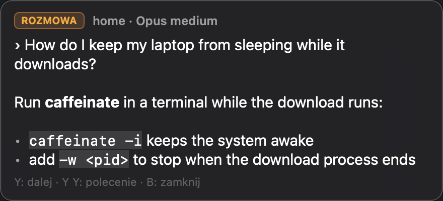
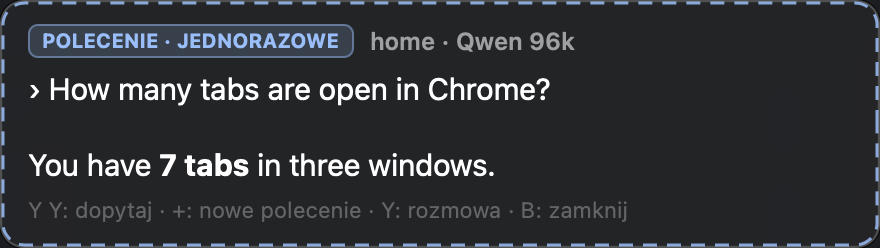
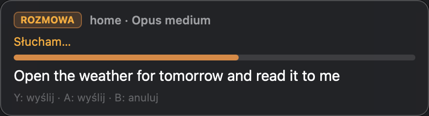
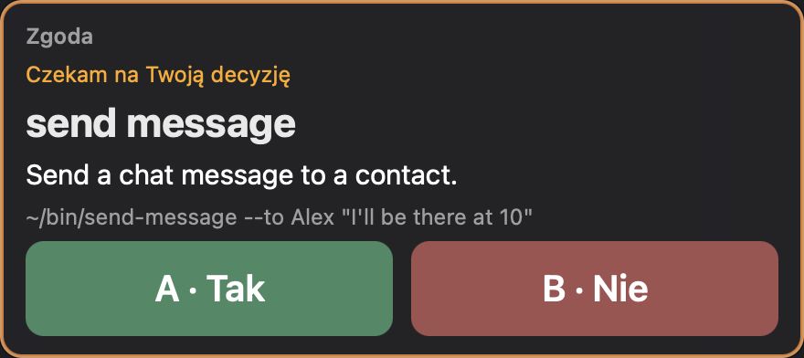
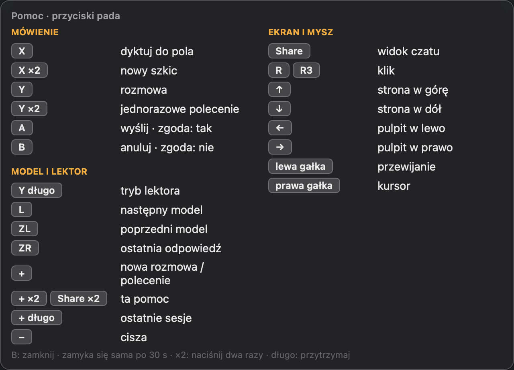
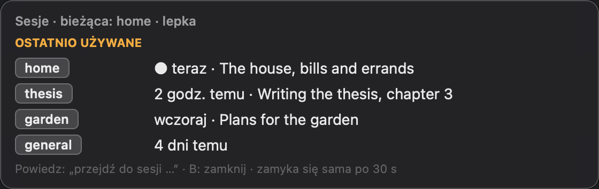
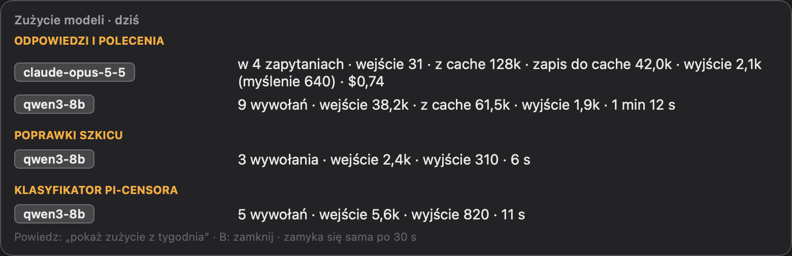
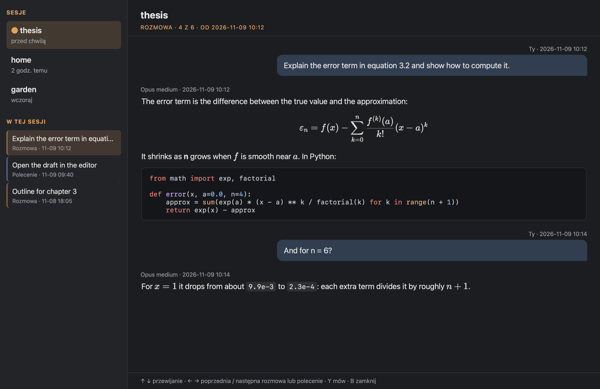

# A tour of Kuterlapa

Kuterlapa lets you use a Mac by voice and a game controller. This page
shows what you see while you use it. The screenshots use made-up example
content; `make screenshots` takes them again (Kuterlapa must run).

The interface speaks Polish, as its first user does. The text in the
pictures is translated below each one.

## The overlay

A small panel in the top right corner of the screen. It never takes the
keyboard focus, so the application below keeps working, and mouse clicks
pass through it.

### A conversation

Y starts a conversation with a model (Claude through `claude -p`, or a
local model through `pi`) in the current session. The badge **ROZMOWA**
("conversation") says that it is saved in the session's history. Answers
are Markdown: bold text, lists and code show as such. The title shows the
session and the model profile.

While the model works, the overlay shows what it does, in small text: each
tool call with its arguments (⋯ running, ✓ done, ✗ failed), the latest part
of its thinking, the seconds and the tokens so far. Tokens "wej." are what
the model read, all its calls together; "wyj." are what it wrote. After the
answer, one small line keeps the totals.

### A one-off command

Y pressed twice asks a one-off question. It sees the session's context but
is not saved in its conversation. The blue badge **POLECENIE ·
JEDNORAZOWE** ("command · one-off") and the dashed frame mark it as
temporary: it lasts while its answer is on screen.

### Listening, and the pause countdown

While you speak, the text appears piece by piece (**Słucham…**,
"listening"). A message sends itself after a pause: after one second of
silence a bar counts down, and speaking again stops it. All three times
(pause, countdown, the shortest recording) are settings.

### A question before a tool runs

Models act through tools: programs described by small TOML files, and
built-in tools that see and use the computer. A tool can ask first. The
overlay then shows the tool's name large, what it does, the exact
command, and two large buttons: **A · Tak** (yes) and **B · Nie** (no). A
frame and a sound make sure you notice it.

A model can also ask you itself (`ask_user`): yes or no, or one of a few
options. Options stand one under another; the d-pad's up and down move the
mark, A chooses, B cancels.

pi runs in its RPC mode, so its extensions can ask too. When pi-censor is
unsure of a tool call, its question (allow once, allow for the rest of
the conversation, deny) shows the same way.

### The help

Pressing + or Share twice shows what every button does, built from your
`mapping.json`, so it always matches your buttons. Groups: speaking, the
model and the narrator, the screen and the mouse. "×2" means press twice,
"długo" means hold.

### Recent sessions

Sessions are named contexts for work, each with its own conversations,
notes for the models, speech recognition words and project folder. Holding
+ shows the recently used ones; a voice command switches between them. A
session can also follow the window in front.

### Token statistics

How many tokens each model used: today, in the last 7 or 30 days, or in
all. Answers and commands, draft corrections and pi-censor's classifier
are apart. For each model: tokens read anew, read from the cache and
written to it, written (with the thinking, where the engine counts it),
web searches, cost and time, where the engine reports them. Claude reports
each model once for a whole request, also the models Claude Code uses on
its own. pi reports each call. pi-censor reports its classifier calls as
`pi-censor-usage` session entries. A model shows this panel with
`usage_stats`; `kuterlapa stats` prints it.

## The chat view

Share opens the whole conversation on the whole screen, for reading from a
distance: Markdown, formulas (KaTeX) and highlighted code. On the left are
the sessions and, below them, the session's conversations and commands.
The controller works in it: up and down scroll, left and right go to older
and newer conversations, B closes it. A model can also open it at a past
message it found by meaning ("show me where we talked about …").

The overlay stays hidden while the chat view is open. The view shows the
model's work itself: below the question, a card lists the tool calls with
their arguments and the start of each result, the thinking, the tokens and
the seconds. Each answer keeps its totals and its tool calls below it.
